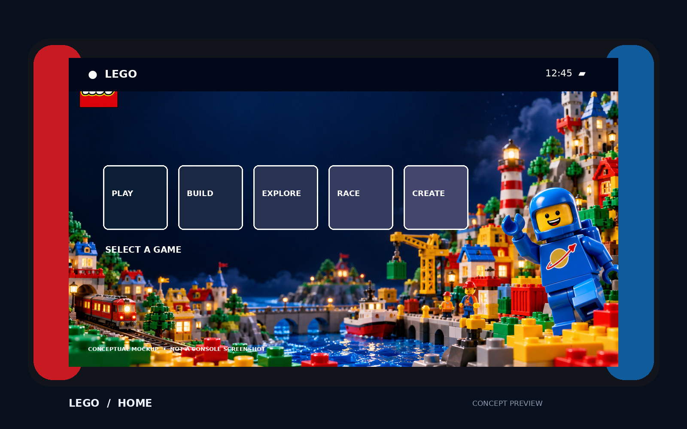
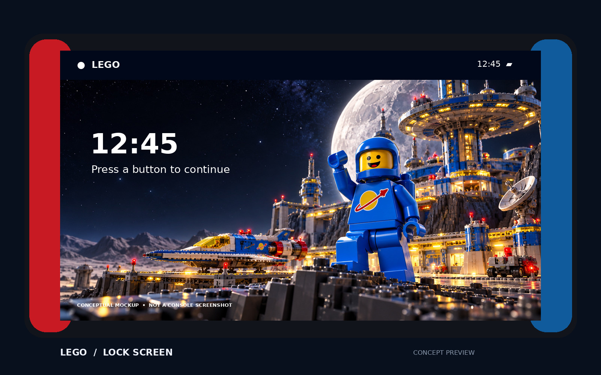
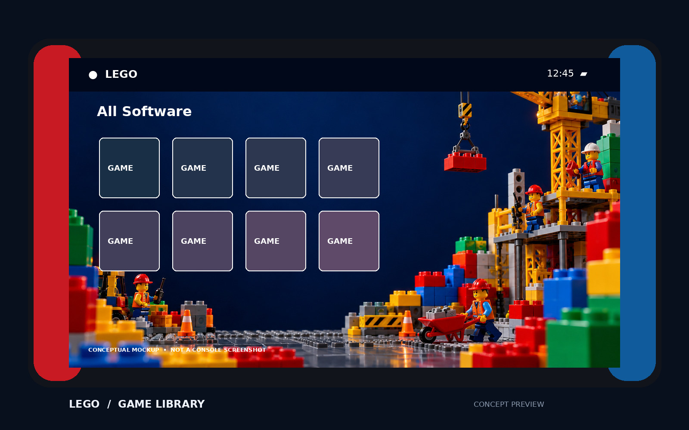
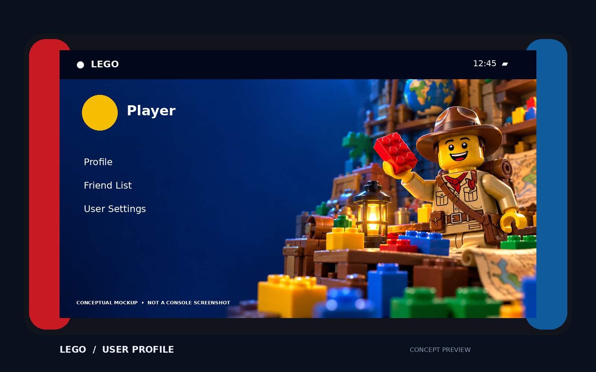
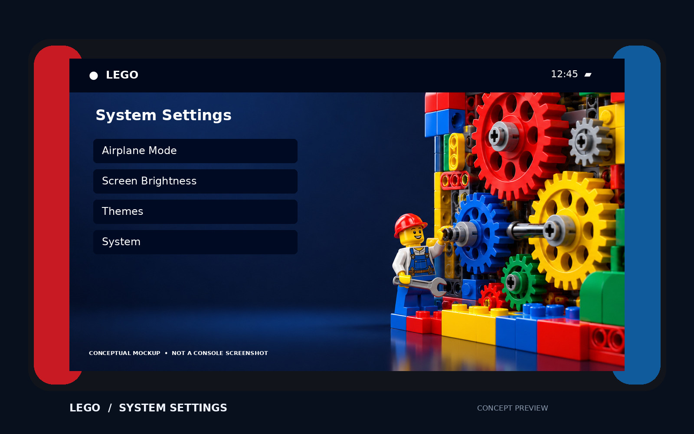

# تم لگو برای نینتندو سوئیچ

پروژه‌ای هواداری و غیررسمی برای خانوادهٔ اصلی Nintendo Switch. هفت فایل جداگانه، پس‌زمینهٔ بخش‌های مختلف را تغییر می‌دهند و از چیدمان اصلی سیستم استفاده می‌کنند؛ آیکون‌ها و ناوبری سیستم بازطراحی نشده‌اند.

[دانلود بستهٔ کامل](dist/LEGO-Nintendo-Switch-Theme.zip) · [فایل‌های جداگانه](themes/) · [هش فایل‌ها](dist/SHA256SUMS.txt) · [English](README.md)

## پیش‌نمایش‌ها

تصاویر زیر **ماکاپ مفهومی** هستند، نه اسکرین‌شات کنسول. آیکون‌ها، متن‌ها و جای‌گذاری‌ها نمایشی‌اند و ظاهر واقعی بسته به نسخه و تنظیمات سیستم متفاوت است.

## فایل‌ها

| بخش | فایل |
|---|---|
| صفحهٔ اصلی | [LEGO-Home](themes/LEGO-Home.nxtheme) |
| صفحهٔ قفل | [LEGO-Lock](themes/LEGO-Lock.nxtheme) |
| فهرست بازی‌ها | [LEGO-Games](themes/LEGO-Games.nxtheme) |
| پروفایل | [LEGO-Profile](themes/LEGO-Profile.nxtheme) |
| تنظیمات | [LEGO-Settings](themes/LEGO-Settings.nxtheme) |
| اخبار | [LEGO-News](themes/LEGO-News.nxtheme) |
| انتخاب کاربر | [LEGO-Player-Select](themes/LEGO-Player-Select.nxtheme) |

تصویر اخبار از طرح کتابخانه و تصویر انتخاب کاربر از طرح پروفایل استفاده می‌کند.

## سازگاری و بررسی

برای Switch، Switch OLED و Switch Lite با نسخهٔ سازگار Atmosphère و NXThemes Installer نسخهٔ ۳ یا جدیدتر طراحی شده است. Switch 2 هدف پروژه نیست. طبق یادداشت انتشار ابزار اصلی، نسخهٔ ۳.۰.۲ از سیستم‌عامل ۲۳.۰ و ۲۳.۰.۱ با Atmosphère نسخهٔ ۱.۱۲.۱ یا جدیدتر پشتیبانی می‌کند. سازگاری سایر نسخه‌ها و وصله‌ها را در [انتشارهای ابزار اصلی](https://github.com/exelix11/SwitchThemeInjector/releases) بررسی کنید.

هر هفت فایل با NxThemeTool و کد پروژهٔ اصلی با شناسهٔ `66ccc56c` بسته‌بندی و بدون هشدار اعتبارسنجی شدند؛ ساختار آرشیو، هدف هر فایل و ابعاد تصویر نیز بررسی شد. **نصب روی کنسول واقعی، خوانایی در تم روشن یا تیره و سازگاری نسخهٔ خاصی از سیستم‌عامل آزمایش نشده‌اند.** تصاویر با هوش مصنوعی ساخته شده‌اند و صحنهٔ سه‌بعدی قابل ویرایش ندارند. فایل سیستمی نینتندو در پروژه موجود نیست.

## نصب

۱. از کارت حافظه نسخهٔ پشتیبان بگیرید و سازگاری CFW، نصب‌کننده و وصله‌ها را بررسی کنید. پیش از به‌روزرسانی سیستم‌عامل، تم را حذف کنید.
۲. فایل ZIP را استخراج و فایل‌های `.nxtheme` را در پوشهٔ `/themes/` کارت حافظه کپی کنید.
۳. NXThemes Installer را اجرا کنید، بخش‌های دلخواه را نصب و کنسول را دوباره راه‌اندازی کنید. راهنمای به‌روز و استخراج داده‌های سیستم در [پروژهٔ اصلی](https://github.com/exelix11/SwitchThemeInjector) موجود است.
۴. اگر کنسول بالا نیامد، دستورالعمل بازیابی پروژهٔ اصلی را دنبال کنید. حذف عادی از داخل نصب‌کننده انجام می‌شود.

## ساخت و رفع مشکل

Python 3، Pillow، ابزار NxThemeTool و .NET 8 لازم‌اند. در لینوکس یا مک، با جایگزین‌کردن مسیر ابزار، دستور `DOTNET=dotnet NXTHEME_TOOL=/path/to/NxThemeTool.dll python3 scripts/build.py` را اجرا کنید. پوشهٔ `artwork/originals` تصاویر اصلی، `artwork/backgrounds` خروجی‌ها، `themes` فایل‌های تم، `previews` ماکاپ‌ها و `dist` بسته و هش‌ها را نگهداری می‌کند. اگر نصب ناموفق بود، نسخهٔ نصب‌کننده، سیستم‌عامل و وصله‌ها را بررسی کنید. اگر متن با تصویر تداخل داشت آن بخش را حذف کنید. برای بازیابی بوت به راهنمای اصلی مراجعه کنید.

ساخته‌شده برای امیر سعید دهقان. ابزار ساخت و نصب: [SwitchThemeInjector](https://github.com/exelix11/SwitchThemeInjector). LEGO و Nintendo متعلق به صاحبان خود هستند؛ این پروژه هیچ وابستگی یا تأیید رسمی از آن‌ها ندارد.

